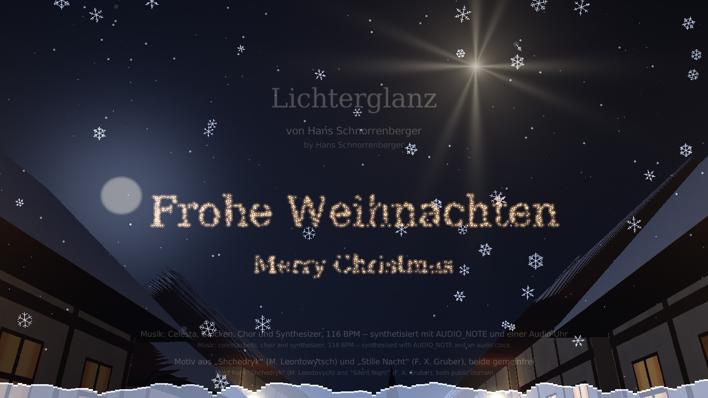
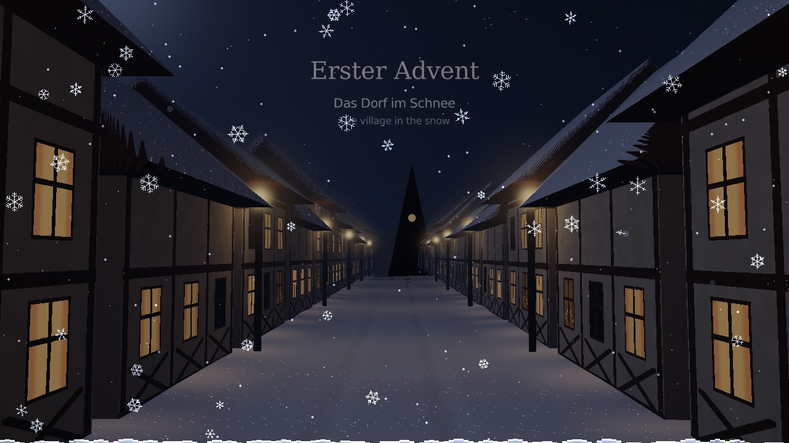
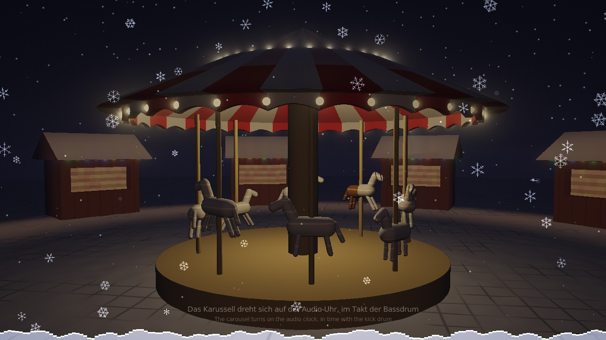
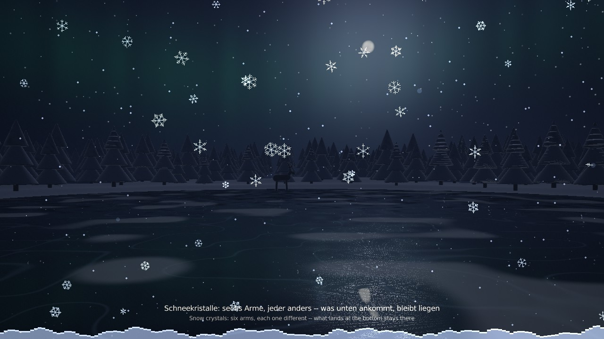
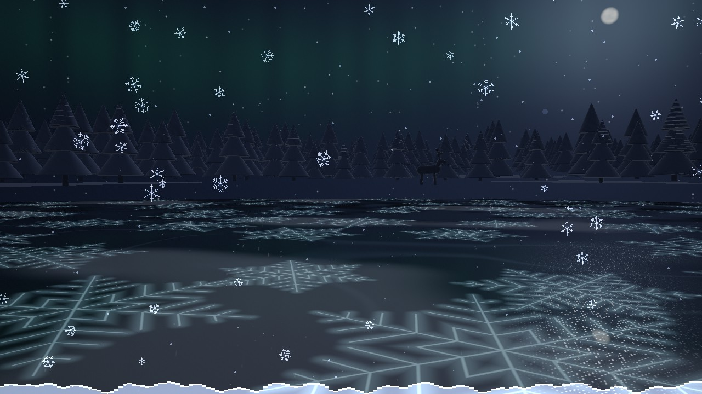
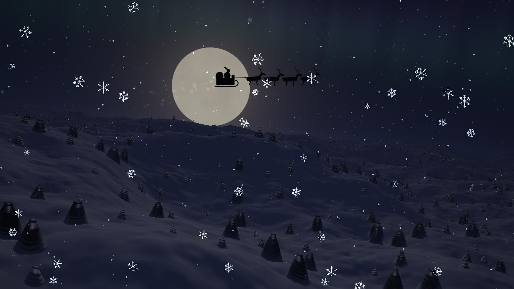
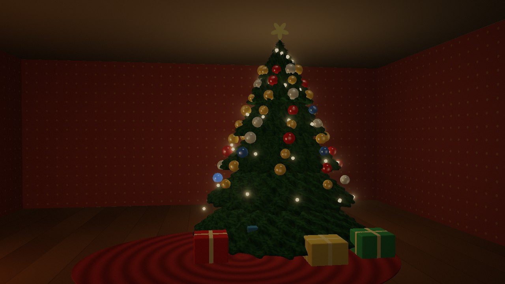
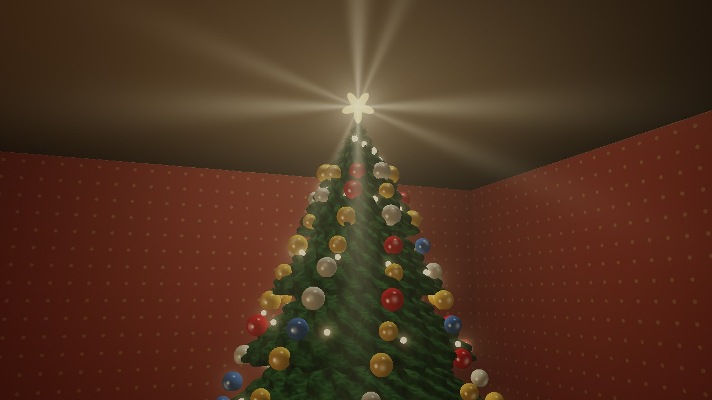

# Lichterglanz

[English](README.md) · **Deutsch**

Eine Weihnachtsdemo von Hans Schnorrenberger, geschrieben in
[Drachenhauch](https://github.com/HasoSchno70/Drachenhauch):
festlich-elektronische Musik, knapp vier Minuten. Eine Reise über den
Adventskranz -- zu jeder Kerze ein Kapitel: ein verschneites Dorf bei Nacht,
der Weihnachtsmarkt mit dem Karussell, ein zugefrorener See im Winterwald, auf
dem Eiskristalle mit der Melodie wachsen, ein Schlittenflug vor dem Mond. Am
Heiligabend sieht man durchs Fenster in die Stube: der Baum schmückt sich
Kugel für Kugel zu „Stille Nacht“, um Mitternacht schlagen die Glocken
zwölfmal, und der Stern auf der Spitze geht auf. Musik, Geräusche und Bild
entstehen alle im Programm selbst: es steckt keine einzige Klang- oder
Bilddatei darin.

**▶ Im Browser ansehen: https://hasoschno70.github.io/Lichterglanz/**

Einmal klicken zum Starten (Browser spielen Ton erst nach einem Klick),
Kopfhörer aufsetzen, ⛶ für Vollbild. Beim ersten Mal lädt die Seite etwa
20 MB.

## Die Reise

| | |
|---|---|
|  |  |
| **Adventskranz** -- Tannengrün, Beeren, vier rote Kerzen; mit jeder Kerze fliegt die Kamera in die Flamme | **Erster Advent: das Dorf** -- Fachwerkhäuser, warme Fenster mit Schwibbögen, Laternen, die Kirche am Ende der Gasse |
|  |  |
| **Zweiter Advent: der Weihnachtsmarkt** -- Buden mit Lichterketten, Dampf vom Glühwein, ein Karussell, das sich auf der Audio-Uhr dreht | **Dritter Advent: der Winterwald** -- ein zugefrorener See, verschneite Tannen, ein Reh im Mondlicht, Polarlicht |
|  |  |
| **Eisblumen** -- sechsarmige Kristalle wachsen über das Eis und leuchten mit jedem Ton | **Vierter Advent: der Flug zum Mond** -- tief über Hügel und Dörfer, ein Schlitten mit vier Rentieren, dahinter Goldstaub |
|  |  |
| **Heiligabend** -- durchs Fenster mit den Eisblumen in die Stube: Kamin, Geschenke, ein Baum, der sich zu „Stille Nacht“ schmückt | **Mitternacht** -- zwölf Glockenschläge, jeder schickt einen Lichtring vom Baum aus, dann geht der Stern auf |

## Wie es gemacht ist

* **Musik:** Ton für Ton synthetisiert (`AUDIO_NOTE`) und auf einer Audio-Uhr
  gespielt, 116 Schläge je Minute: Celesta, Spieluhr, Röhrenglocken,
  Schlittenschellen, Streicher, Chor, Klavier und Supersaw-Flächen. Das
  Glockenmotiv aus „Shchedryk“ (Mykola Leontowytsch, 1916 -- bekannt als
  „Carol of the Bells“) zieht sich durch alles, „Stille Nacht“ (Franz Xaver
  Gruber, 1818) kommt im 6/8-Takt; beide sind gemeinfrei.
* **Geräusche:** Kaminknistern, Schritte im Schnee, ferne Kirchenglocken,
  Stimmengewirr auf dem Markt, Wind und eine Eule im Wald, das Ticken der Uhr
  vor Mitternacht. Die Stimme kommt aus der Sprachausgabe des Systems.
* **Bilder:** jede Szene ist ein Fragment-Shader (Raymarching durch
  Abstandsfelder); der Schnee davor ist 2D -- die nahen Flocken sind echte
  sechsarmige Kristalle, und was unten ankommt, bleibt liegen: von Kapitel zu
  Kapitel wird die Decke höher.
* **Alles folgt der Musik:** jeder Ton von „Stille Nacht“ hängt eine Kugel
  mehr an den Baum, die Eisblumen leuchten mit der Melodie, das Lauflicht des
  Karussells läuft mit der Bassdrum.

## Was in diesem Repository liegt

Die Fassung für den Browser: die Drachenhauch-Laufzeit `dhrt` als WebAssembly
(`dhrt.wasm`, `dhrt.js`, `dhrt.data` mit den Shadern) und der Quelltext
`program.dh`, der beim Start der Seite im Browser übersetzt wird. Zum
Ausprobieren auf dem eigenen Rechner den Ordner mit einem beliebigen
Webserver ausliefern, z. B. `python -m http.server`, und die Seite öffnen.

Die Lizenzen der in `dhrt.wasm` enthaltenen Bibliotheken stehen in
[THIRD-PARTY-NOTICES.txt](THIRD-PARTY-NOTICES.txt).
