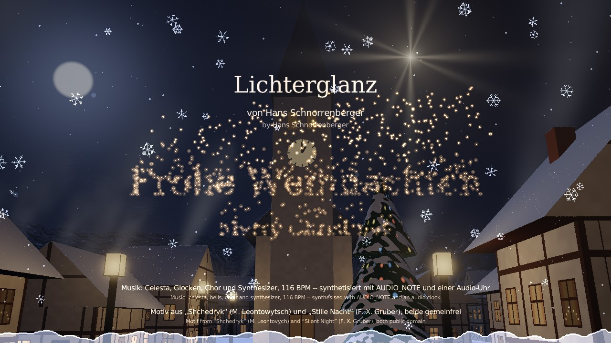
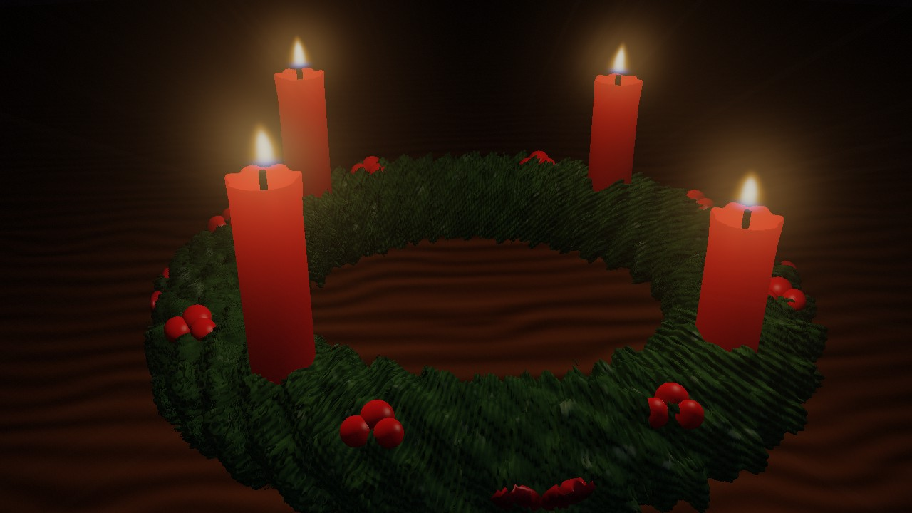
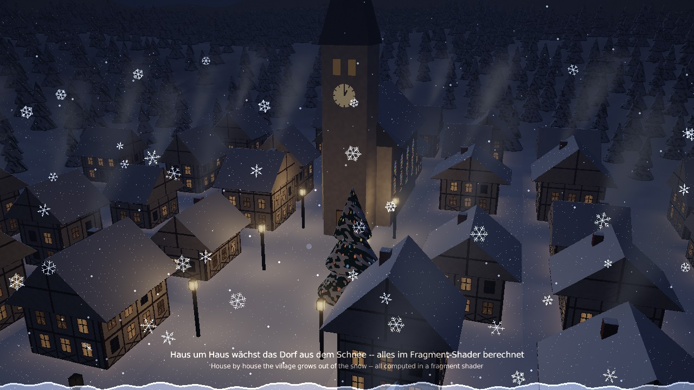
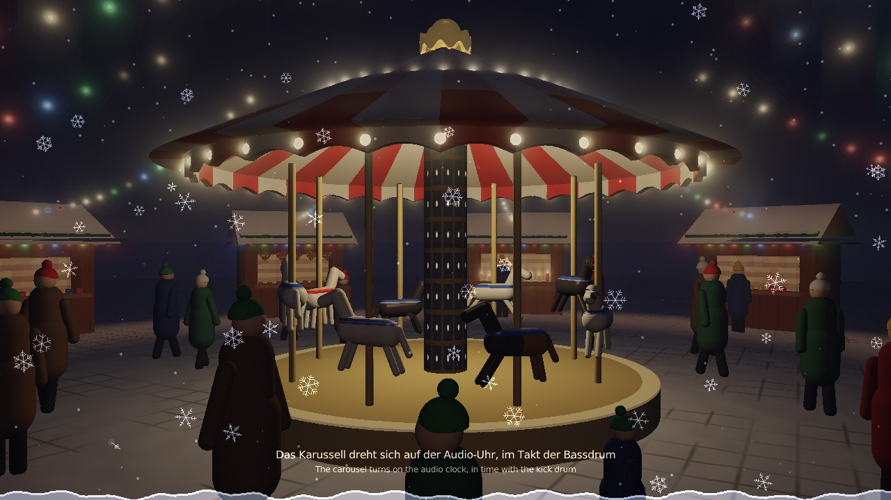
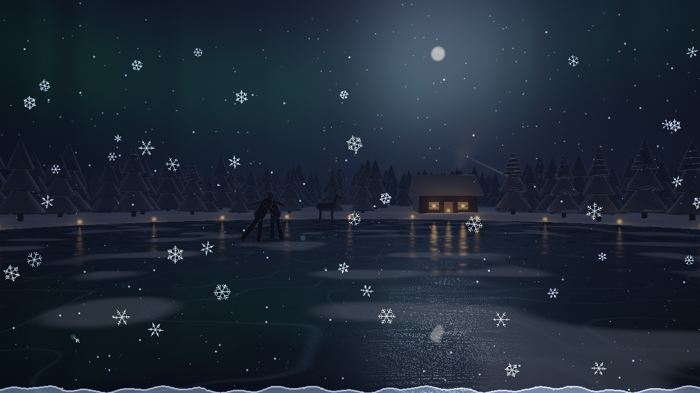
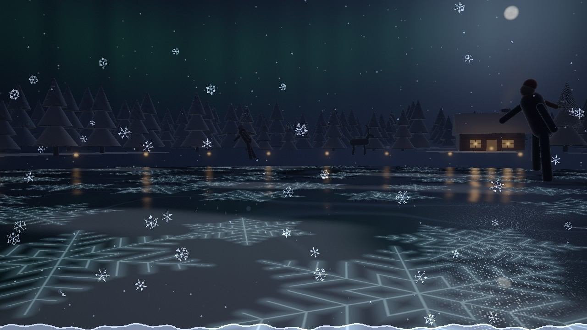
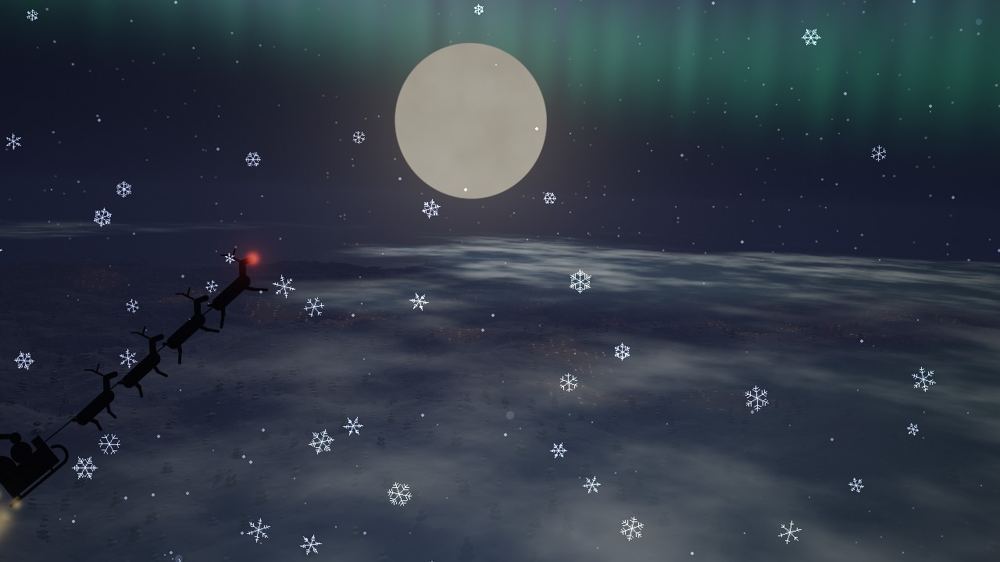
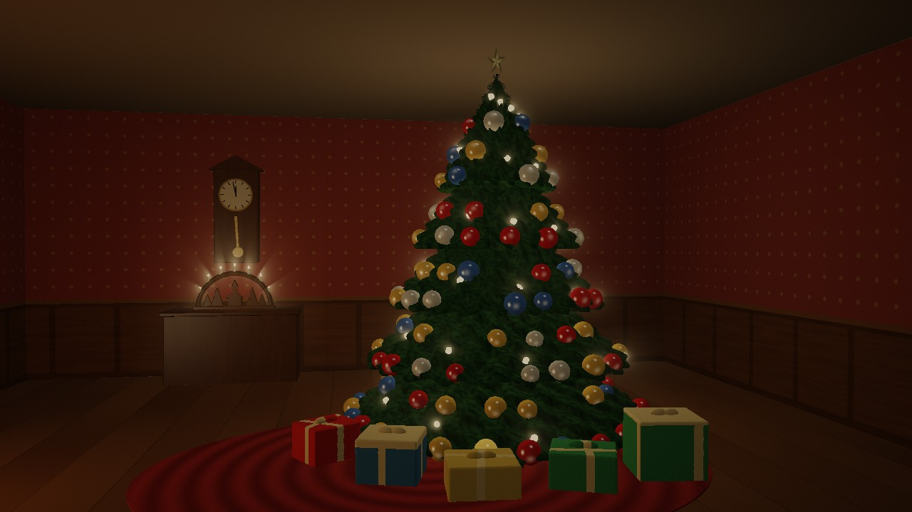
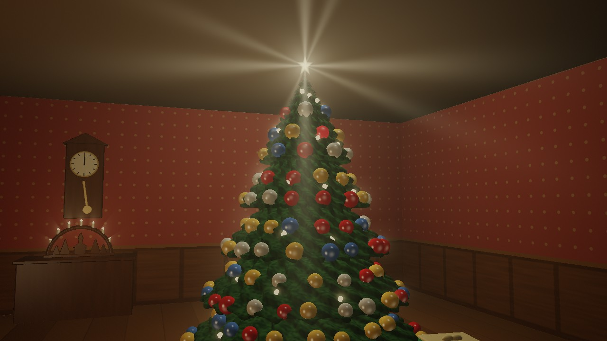

# Lichterglanz -- Glow of Lights

**English** · [Deutsch](README.de.md)

A Christmas demo by Hans Schnorrenberger, written in
[Drachenhauch](https://github.com/HasoSchno70/Drachenhauch): festive
electronic music, a little under four minutes. A journey around the Advent
wreath -- one chapter for each candle: a village that grows out of the snow
house by house, the Christmas market with its carousel and people, a frozen
lake in the winter forest with a cabin and skaters, where ice crystals grow
with the melody, a sleigh flight through the clouds to the moon. On
Christmas Eve the window opens into the living room: the tree unfolds and
decorates itself bauble by bauble to "Silent Night", at midnight the bells
strike twelve, and the star on top lights up. Music, sounds and pictures are
all made by the program itself: there is not a single sound or image file
in it.

**▶ Watch it in your browser: https://hasoschno70.github.io/Lichterglanz/**

Click once to start (browsers only play sound after a click), put on
headphones, ⛶ for full screen. The first load is about 20 MB.

## The journey

| | |
|---|---|
|  |  |
| **Advent wreath** -- fir, berries, four red candles; each one lights up on a bell stroke, and the camera flies into its flame | **First Advent: the village** -- above a valley in the forest the church grows out of the snow, then house after house; windows light up, smoke rises, lanterns and the village tree glow |
|  |  |
| **Second Advent: the Christmas market** -- stalls full of candles, baubles and gingerbread hearts, strings of lights, people in bobble hats, a carousel turning on the audio clock | **Third Advent: the winter forest** -- a frozen lake, a cabin with warm windows, ice lanterns mirrored in the ice, skaters, a deer, an owl crossing the moon |
|  |  |
| **Frost flowers** -- six-armed crystals grow across the ice and light up with every note | **Fourth Advent: the flight to the moon** -- low over hills and villages, then up through the clouds; above a sea of clouds the sleigh, led by a red nose, draws a ribbon of gold dust to the moon |
|  |  |
| **Christmas Eve** -- the window opens into the room: fireplace, clock, candle arch, presents; the tree unfolds, its lights come on, it decorates itself to "Silent Night" | **Midnight** -- the clock strikes twelve, each bell stroke sends a ring of light from the tree, then the star rises |

## How it is made

* **Music:** synthesised note by note (`AUDIO_NOTE`) and played on an audio
  clock, 116 beats per minute: celesta, music box, tubular bells, sleigh
  bells, strings, choir, piano, supersaw pads, brass and timpani (fanfares
  for the chapters, the star rising with full brass). The bell motif from
  "Shchedryk" (Mykola Leontovych, 1916 -- known as "Carol of the Bells")
  runs through everything, and "Silent Night" (Franz Xaver Gruber, 1818)
  comes in 6/8 time; both are in the public domain.
* **Sounds:** crackling fire, footsteps in the snow, distant church bells,
  the murmur of the market, wind and an owl in the forest, the ticking clock
  before midnight. The voice comes from the system's speech output.
* **Pictures:** every scene is a fragment shader (raymarching through
  distance fields); the snow in front of it is 2D -- the near flakes are
  real six-armed crystals, and what reaches the bottom stays there, so the
  snow gets deeper from chapter to chapter.
* **Everything follows the music:** every note of "Silent Night" hangs one
  more bauble on the tree, the frost flowers glow with the melody, the
  carousel lights run with the kick drum.

## What is in this repository

The browser version: the Drachenhauch runtime `dhrt` compiled to WebAssembly
(`dhrt.wasm`, `dhrt.js`, `dhrt.data` with the shaders) and the source
`program.dh`, which is compiled in the browser when the page starts. To try
it locally, serve the folder with any static web server, e.g.
`python -m http.server`, and open the page.

The licences of the libraries contained in `dhrt.wasm` are listed in
[THIRD-PARTY-NOTICES.txt](THIRD-PARTY-NOTICES.txt).
